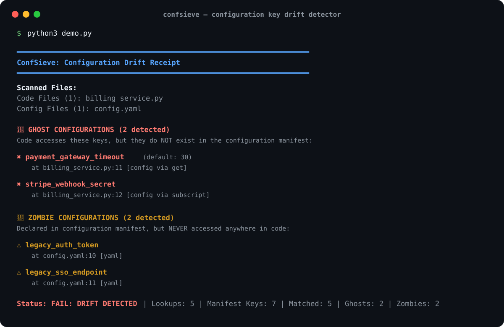

# ConfSieve 🔍⚙️

> **Zero-dependency configuration key drift detector: finds ghost configuration accesses in code and zombie keys in YAML/JSON/TOML manifests.**

[]()
[-blue.svg)]()
[]()
[]()

---


*Figure 1: Conceptual overview of ConfSieve comparing Python AST lookups against YAML, JSON, and TOML manifests.*

---

## The Problem

Modern applications externalize configuration into manifest files (`config.yaml`, `config.json`, `config.toml`, `settings.json`). Over time, code and configuration files silently drift out of sync:

1. **Ghost Configurations (Production Bombs)**:
   - A developer adds `config.get("payment_timeout_seconds", 30)` or `config["stripe_secret"]` inside a service.
   - They forget to declare it in `config.example.yaml` or staging manifests.
   - In production, the service crashes on boot with `KeyError` or silently falls back to unintended defaults that operators cannot override.

2. **Zombie Configurations (Dead Weight)**:
   - Features are refactored or removed, but their entries in `config.yaml` remain forever.
   - Operators waste hours tuning parameters that the application no longer reads.

3. **Silent Typos & Mismatches**:
   - `database.pool_size` vs `db.pool_size` passes standard YAML/JSON linters because the syntax is valid, yet the application fails at runtime.

`ConfSieve` solves this by statically comparing your codebase's AST lookups against your configuration manifests, providing instant feedback in your terminal or CI/CD pipeline with **zero external dependencies**.

---

## Live Terminal Demo


*Figure 2: Reproducible terminal output from `python3 demo.py` detecting ghost keys and zombie manifest entries.*

---

## Key Features

- ⚡ **Zero External Dependencies**: Runs entirely on Python's standard library (`ast`, `json`, `tomllib`). Includes a native indentation-based YAML key extractor without needing PyYAML.
- 🎯 **Deep AST Code Extraction**: Detects dictionary subscripts (`config["db"]["port"]`), method lookups (`config.get("timeout", 5)`), and attribute accesses (`settings.PORT`).
- 📁 **Multi-Format Manifest Support**: Scans `.yaml`, `.yml`, `.json`, and `.toml` configuration manifests.
- 🚦 **CI/CD Ready**: Exits `0` on clean parity and `1` on drift. Includes `--json` output for automated tooling.
- 🛡️ **Safe & Read-Only**: Performs purely offline static analysis. Never executes code or sends network telemetry.

---

## Quick Start

### 1. Run the interactive demo
```bash
python3 demo.py
```

### 2. Scan your project with ConfSieve
```bash
# Scan current directory code against config.yaml
./run_confsieve.py --code src/ --config config.yaml

# Scan against multiple config files
./run_confsieve.py --code src/ --config config.yaml settings.json

# Ignore specific dynamic keys
./run_confsieve.py --code src/ --config config.yaml --ignore temp_secret
```

---

## Command-Line Options

```
usage: confsieve [-h] [--version] [--code CODE [CODE ...]] --config CONFIG
                 [CONFIG ...] [--ignore IGNORE]
                 [--target-object TARGET_OBJECT] [--no-fail-on-zombie]
                 [--no-fail-on-ghost] [--json] [--no-color]

Options:
  -c, --code            Python files or directories to scan (default: current directory)
  -f, --config          Configuration manifest files (.yaml, .json, .toml)
  -i, --ignore          Configuration key path(s) to ignore
  --target-object       Custom config variable names (default: config, cfg, settings, etc.)
  --no-fail-on-zombie   Report zombie keys as warnings without failing exit code
  --no-fail-on-ghost    Do not fail build on ghost keys
  --json                Emit machine-readable JSON output
  --no-color            Disable ANSI color escapes
```

---

## Running Automated Tests

Run the full test suite using Python's built-in `unittest`:

```bash
python3 -m unittest discover tests
```

All 18 tests execute in under 20 milliseconds.

---

## License

MIT License. See [LICENSE](LICENSE) for details.
